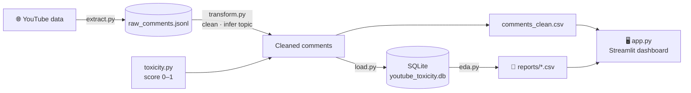

<div align="center">

# 🫧 Toxiscope

### Read the room, comment by comment.

**An end-to-end analytics pipeline and interactive dashboard that measures toxicity in YouTube comment sections.**

[](https://yt-toxicity-analyzer-wuuq6at4kprjmpzlnekc43.streamlit.app)


[**Live demo**](https://yt-toxicity-analyzer-wuuq6at4kprjmpzlnekc43.streamlit.app) · [**Key findings**](#-key-findings) · [**How it works**](#-system-design) · [**Run it**](#-quick-start) · [**Deploy**](#-deployment)

</div>

---

## 📌 At a glance

| 💬 Comments analysed | 🚩 Flagged toxic | 📉 Average score | 📺 Channels | 🎬 Videos in correlation test |
|:---:|:---:|:---:|:---:|:---:|
| **25,456** | **39** (0.15 %) | **0.009** (scale 0–1) | **3** | **51** |

> ⚠️ **Please read:** toxicity values are *model estimates* of how likely a comment is to be toxic. They are **not** judgments about individual people, and a low rate does not prove a community is "healthy".

---

## 🎯 The question behind the project

Large channels receive thousands of comments per video. Nobody can read them all, and simple keyword filters miss context. Moderators, brand-safety teams and community managers need a fast answer to two questions:

1. **How toxic are these comment sections, and where is the toxicity concentrated?**
2. **Does a video's popularity change how toxic its comments are?**

Toxiscope answers both with a reproducible data pipeline and an explorable dashboard.

---

## 🔑 Key findings

<table>
<tr>
<td width="50%" valign="top">

### Toxicity is rare, but uneven
| Channel | Comments | Toxic | Rate |
|---|--:|--:|--:|
| Rick Astley | 495 | 3 | **0.61 %** |
| Marques Brownlee | 12,493 | 30 | **0.24 %** |
| MrBeast | 12,468 | 6 | **0.05 %** |

*Rick Astley is a single video, so its rate rests on a small sample.*

</td>
<td width="50%" valign="top">

### Bigger videos ≠ more toxic
| Level | Spearman ρ | p-value | n |
|---|--:|--:|--:|
| Video | **−0.433** | 0.0015 | 51 videos |
| Comment | **−0.072** | < 0.0001 | 25,456 |

A **moderate negative** video-level link: in this sample, more-viewed videos did *not* have higher toxicity rates.

</td>
</tr>
</table>

> 📝 **Correlation is not causation.** Channel differences (audience, moderation, content type) are not controlled for, and only three channels are covered. See [Limitations](#-limitations).

---

## 🖥️ Dashboard

The Streamlit app (`app.py`) is organised in four tabs:

| Tab | What you can do |
|---|---|
| 📊 **Overview** | See headline metrics, then compare channels (and topics, when more than one exists). **Pick the metric** (toxicity rate, mean score, comment count or toxic count) and **switch between horizontal and vertical bars**. Hover for exact values and comment counts. |
| 🔭 **Reach vs. toxicity** | Spearman correlation cards plus a scatter plot of every video (log views vs. toxicity rate). Channels are told apart by **colour and marker shape**; hover shows title, views and comment count. A dashed linear trend line helps orientation. |
| 🔎 **Comment explorer** | Full-text search, channel filter, minimum-score slider and result count. Results appear as cards coloured by severity (🔴 ≥ 0.70, 🟠 ≥ 0.40, 🟢 below) and can be exported as CSV. |
| 📁 **Data & downloads** | Every report table in an expandable panel with one-click CSV download. |

<details>
<summary><b>📸 Screenshots</b> (click to expand)</summary>

<br>

| Overview | Reach vs. toxicity |
|---|---|
|  |  |

| Comment explorer |
|---|
|  |

</details>

---

## 🏗️ System design



### Pipeline stages

| # | Stage | Module | Responsibility |
|:-:|---|---|---|
| 1 | **Extract** | `extract.py` | Fetch comments and video metadata; write raw JSON Lines. |
| 2 | **Transform** | `transform.py` | Clean text and infer a topic from each video title (`infer_topic`). |
| 3 | **Score** | `toxicity.py` | Produce a `toxicity_score` (0–1) and an `is_toxic` flag per comment. |
| 4 | **Load** | `load.py` | Persist comments and videos to SQLite. |
| 5 | **Analyse** | `eda.py` | Build the report tables, per-video summary and statistics. |
| 6 | **Present** | `app.py` | Interactive dashboard on pre-computed CSV reports. |
| ⚙️ | **Orchestrate** | `main.py` | CLI: `python main.py [extract \| transform \| load \| eda \| all]`. |

### Design principles

- 🧩 **Separation of concerns:** one module per stage, each with a `run()` entry point.
- ⚡ **Decoupled dashboard:** the app reads only CSV files, so it starts instantly, needs **no API keys, database or ML model**, and deploys on a free host.
- 🛡️ **Defensive analysis:** report functions tolerate missing columns, empty groups and non-numeric values and return valid empty results instead of crashing.
- 🏷️ **Honest fallbacks:** a video whose title matches no topic keyword stays in `general` rather than being guessed.
- ♿ **Readable by design:** explicit light-on-dark colours, colour *and* shape to separate channels, and automatic axis margins so labels are never clipped.

---

## 🧮 Methodology

<details>
<summary><b>Toxicity rate and grouping</b></summary>

`toxicity_rate = flagged comments ÷ analysed comments`, calculated per channel and per topic. Topic groups with fewer than **5** comments are omitted from the topic report to avoid noisy rates.
</details>

<details>
<summary><b>Topic inference</b></summary>

`infer_topic()` matches whole words and phrases from a keyword map against the video title (for example *challenge, tech, music, gaming, education, vlog, news*). Word-boundary guards stop accidental matches such as "ai" inside another word, and symbol-led keywords like `$1` are handled separately. Unmatched or empty titles return `general`. The keyword map can be overridden by defining `TOPIC_KEYWORDS` in `config.py`.
</details>

<details>
<summary><b>Reach vs. toxicity statistics</b></summary>

- **Video level:** only videos with **≥ 10 comments** are kept. Spearman correlation between `log(1 + views)` and the video's toxicity rate.
- **Comment level:** Spearman correlation between `log(1 + views)` and each comment's score.
- **Why Spearman?** View counts are extremely skewed (millions vs. billions). A rank-based method is robust to outliers and does not assume linearity.
- Rows with invalid or negative view counts are excluded; degenerate inputs (too few rows, no variation) return no result instead of an error.
</details>

---

## 🗃️ Data model

<details>
<summary><b>Tables and report files</b></summary>

**`comments`** (SQLite table and `data/comments_clean.csv`)

| Column | Description |
|---|---|
| `video_id` | Key linking to `videos`. |
| `text_clean` | Cleaned comment text shown in the explorer. |
| `toxicity_score` | Model estimate between 0 and 1. |
| `is_toxic` | `1` if flagged toxic, else `0`. |
| `topic` | Broad topic inferred from the video title. |
| `channel` | Channel name. |

**`videos`**

| Column | Description |
|---|---|
| `video_id` | Primary key. |
| `channel` | Channel name. |
| `view_count` | Views at collection time. |
| `video_title` | Title used for topic inference. |

**Generated reports in `data/reports/`**

| File | Contents |
|---|---|
| `by_channel.csv` | `comments`, `toxic`, `mean_toxicity`, `median_views`, `toxicity_rate` per channel. |
| `by_topic.csv` | `comments`, `toxic`, `toxicity_rate` per topic (≥ 5 comments). |
| `toxicity_vs_views.csv` | Spearman ρ, p-value and sample size at video and comment level. |
| `per_video.csv` | Per video: views, toxicity rate, comment count, title. |
| `toxicity_eda.png` | Static two-panel chart (channel rate, reach vs. toxicity) for reports. |

</details>

---

## 📂 Project structure

```text
.
├── app.py                     # Streamlit dashboard
├── main.py                    # Pipeline runner (CLI)
├── config.py                  # Paths and settings
├── extract.py                 # Data collection
├── transform.py               # Cleaning + topic inference
├── toxicity.py                # Toxicity scoring
├── load.py                    # SQLite loading
├── eda.py                     # Reports and static chart
├── check_topics.py            # Helper to inspect topic assignment
├── requirements.txt           # Dashboard dependencies (Streamlit Cloud)
├── requirements-pipeline.txt  # Full pipeline dependencies
├── .streamlit/
│   └── config.toml            # Dark theme
├── docs/                      # Screenshots used in this README
└── data/
    ├── comments_clean.csv
    └── reports/               # by_channel · by_topic · toxicity_vs_views · per_video · PNG
```

*Not committed (ignored via `.gitignore`):* `.env`, `.venv/`, `__pycache__/`, `*.db`, `data/raw_comments.jsonl`.

---

## 🚀 Quick start

**Prerequisites:** Python 3.12+ and Git.

```bash
# 1. Clone
git clone https://github.com/sania-Ashfak/<repository-name>.git
cd <repository-name>

# 2. Create and activate a virtual environment
python -m venv .venv
.venv\Scripts\Activate.ps1        # Windows PowerShell
# source .venv/bin/activate       # macOS / Linux

# 3a. Dashboard only (fast)
pip install -r requirements.txt

# 3b. Or the full pipeline
pip install -r requirements-pipeline.txt
```

### ▶️ Run the dashboard

```bash
streamlit run app.py
```
Open <http://localhost:8501>. It reads `data/comments_clean.csv` and `data/reports/*.csv`; if files are missing it shows guidance instead of crashing.

### 🔁 Run the pipeline

Create a `.env` file in the project root with the credentials your extraction step needs (**never commit it**), then:

```bash
python main.py extract     # fetch raw comments
python main.py transform   # clean + topics
python main.py load        # write to SQLite
python main.py eda         # regenerate reports
python main.py all         # everything, in order
```

> 💡 To refresh only the analysis from an existing database: `python main.py eda`.

---

## ☁️ Deployment

The live app runs on **Streamlit Community Cloud**, straight from this repository.

1. Push the repo to GitHub with `app.py`, `requirements.txt`, `.streamlit/config.toml`, `data/comments_clean.csv` and `data/reports/*.csv`.
2. At [share.streamlit.io](https://share.streamlit.io) choose **Create app → Deploy a public app from GitHub**.
3. Select the repository, branch `main`, main file `app.py`, then **Deploy**.

Every `git push` redeploys automatically. Use **Manage app → Reboot app** to force a refresh.

---

## 🧰 Engineering notes

<details>
<summary><b>Problems found and solved while building the dashboard</b></summary>

| Problem | Root cause | Fix |
|---|---|---|
| Unreadable, dull text on the dark UI | Custom dark CSS on top of Streamlit's default light theme; the theme folder was named `streamlit` instead of `.streamlit`, so it was never loaded | Correct folder name plus explicit CSS colours for labels, tabs, selects, sliders and expanders |
| Chart legends invisible | `st.plotly_chart` applied Streamlit's theme over custom colours | `theme=None` with explicit legend fonts |
| Chart labels cut off at the edges | Margins too tight and no automatic axis margins | `automargin=True`, larger margins and tick standoff |
| Channels hard to tell apart | Colour only | Distinct colour **and** marker shape per channel |
| Misleading single-bar topic chart | Every video classified as `general` | Fixed topic matching; the topic section only renders when ≥ 2 topics exist |
| Black chart titles in static image | `set_title(loc="left")` ignores `ax.title.set_color` | `axes.titlecolor` set through `rcParams` |
| Imprecise report values | Rates rounded to 4 decimals | Rounded to 6 decimals |
| Static chart could not be updated from GitHub alone | A generated PNG only changes when `eda.py` is run | Interactive Plotly charts replace it in the dashboard |

</details>

<details>
<summary><b>🔐 Security lesson: keep secrets out of Git</b></summary>

An API key committed by mistake stays in Git history even after the file is deleted. The fix: **revoke and rotate the key**, add `.env` to `.gitignore` *before* the first `git add`, verify with `git check-ignore -v .env`, and rewrite history if a secret was ever pushed. A `.gitignore` must live in the repository root and be saved as plain UTF-8.
</details>

---

## ⚠️ Limitations

- Toxicity is a probabilistic model output; false positives and false negatives are expected, and sarcasm, quotes and in-group language are hard for models.
- Only **0.15 %** of comments are flagged, so rates rest on small counts and move noticeably with a few comments.
- One channel is represented by a single video.
- Topic assignment is keyword-based and depends on video titles.
- Three channels do not represent all of YouTube.

## 🗺️ Roadmap

- [ ] Toxicity trends over a video's lifetime
- [ ] More channels and a channel selector in the dashboard
- [ ] Compare several scoring models and report agreement
- [ ] Automated tests and a scheduled data-refresh workflow

---


<div align="center">

**Built with Python, pandas, SciPy, SQLite, Plotly and Streamlit**

*Toxiscope · YouTube comment analysis*

</div>
