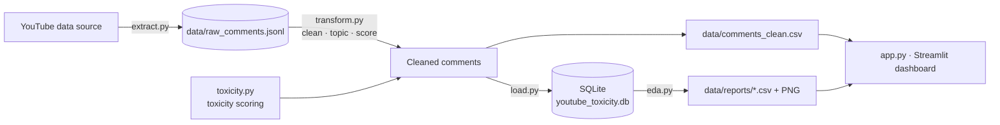

# Toxiscope — YouTube Comment Toxicity Analyzer

An end-to-end data project that collects YouTube comments, cleans them, scores them for toxicity, stores the results in SQLite, runs exploratory analysis, and presents everything in an interactive Streamlit dashboard.

---

## Table of contents

1. [Highlights](#highlights)
2. [Dashboard](#dashboard)
3. [System design](#system-design)
4. [Project structure](#project-structure)
5. [Data model](#data-model)
6. [Analysis methodology](#analysis-methodology)
7. [Getting started](#getting-started)
8. [Running the pipeline](#running-the-pipeline)
9. [Running the dashboard](#running-the-dashboard)
10. [Deploying to Streamlit Community Cloud](#deploying-to-streamlit-community-cloud)
11. [Configuration](#configuration)
12. [Design decisions](#design-decisions)
13. [Limitations](#limitations)
14. [Troubleshooting](#troubleshooting)
15. [Roadmap](#roadmap)

---

## Highlights

- **ETL pipeline** — extract → transform → load → EDA, runnable step by step or all at once.
- **25,456 comments** analysed across **3 channels** (MrBeast, Marques Brownlee, Rick Astley); **39 comments (0.15 %)** flagged as toxic.
- **Statistical analysis** — Spearman rank correlation between video reach (views) and toxicity at video level and comment level.
- **Interactive dashboard** — Plotly charts with metric picker and horizontal/vertical toggle, a searchable comment explorer with severity colouring, and CSV downloads.
- **Reproducible reports** — every table and chart is regenerated by one command (`python main.py eda`).

## Dashboard

The Streamlit app (`app.py`) has four tabs:

| Tab | What it shows |
|---|---|
| **Overview** | Headline metrics (comments analysed, flagged toxic, average score) and interactive bar charts per channel and, when more than one topic exists, per topic. Choose the metric (toxicity rate, mean score, comment count, toxic count) and the orientation. |
| **Reach vs. toxicity** | Spearman correlation cards and a scatter plot of every video (log views vs. toxicity rate). Channels are distinguished by both colour and marker shape; hover shows the video title, views and comment count. |
| **Comment explorer** | Search comment text, filter by channel and minimum score, and list the highest-scoring comments as cards coloured by severity. Export the filtered result as CSV. |
| **Data & downloads** | Every report table with download buttons, plus the static EDA image for use in documents. |

Severity colours in the explorer: score ≥ 0.70 **high**, ≥ 0.40 **medium**, otherwise **low**.

## System design



**Design principles**

- **Separation of concerns** — each stage is its own module with a `run()` entry point, orchestrated by `main.py`.
- **The dashboard is decoupled from the pipeline.** It reads only pre-computed CSV files from `data/`, so it starts instantly, needs no API keys, no database and no ML model, and can be deployed on a free host.
- **Defensive analysis code** — report functions tolerate missing columns, empty groups and non-numeric values, and return empty-but-valid results instead of crashing.
- **Honest fallbacks** — comments whose video title matches no topic keyword stay in a `general` bucket instead of being guessed.

### Pipeline stages

| Stage | Module | Responsibility |
|---|---|---|
| Extract | `extract.py` | Fetch comments and video metadata and write raw JSON Lines. |
| Transform | `transform.py` | Clean comment text, infer a topic from the video title (`infer_topic`), and prepare the records for scoring. |
| Score | `toxicity.py` | Produce a `toxicity_score` (0–1) and an `is_toxic` flag per comment. |
| Load | `load.py` | Persist comments and videos to SQLite. |
| EDA | `eda.py` | Build report tables and the static dashboard chart. |
| Present | `app.py` | Interactive Streamlit dashboard. |
| Orchestrate | `main.py` | CLI: `python main.py [extract\|transform\|load\|eda\|all]`. |

## Project structure

```
.
├── app.py                    # Streamlit dashboard
├── main.py                   # Pipeline runner (CLI)
├── config.py                 # Paths and settings (DB_PATH, REPORT_DIR, …)
├── extract.py                # Data collection
├── transform.py              # Cleaning + topic inference
├── toxicity.py               # Toxicity scoring
├── load.py                   # SQLite loading
├── eda.py                    # Reports and charts
├── check_topics.py           # Helper to inspect topic assignment
├── requirements.txt          # Dashboard dependencies (used by Streamlit Cloud)
├── requirements-pipeline.txt # Full pipeline dependencies
├── .streamlit/
│   └── config.toml           # Dark theme for the dashboard
└── data/
    ├── raw_comments.jsonl    # Raw extract            (not committed)
    ├── youtube_toxicity.db   # SQLite database        (not committed)
    ├── comments_clean.csv    # Cleaned, scored comments
    └── reports/
        ├── by_channel.csv
        ├── by_topic.csv
        ├── toxicity_vs_views.csv
        ├── per_video.csv
        └── toxicity_eda.png
```

## Data model

**`comments`** (SQLite table / `comments_clean.csv`)

| Column | Description |
|---|---|
| `video_id` | Foreign key to `videos`. |
| `text_clean` | Cleaned comment text shown in the explorer. |
| `toxicity_score` | Model estimate between 0 and 1. |
| `is_toxic` | 1 if the comment is flagged toxic, otherwise 0. |
| `topic` | Broad topic inferred from the video title (`general` if unknown). |
| `channel` | Channel name (also available via the `videos` table). |

**`videos`**

| Column | Description |
|---|---|
| `video_id` | Primary key. |
| `channel` | Channel name. |
| `view_count` | Views at collection time. |
| `video_title` | Title used for topic inference. |

**Generated reports (`data/reports/`)**

| File | Contents |
|---|---|
| `by_channel.csv` | Per channel: `comments`, `toxic`, `mean_toxicity`, `median_views`, `toxicity_rate`. |
| `by_topic.csv` | Per topic (groups with ≥ 5 comments): `comments`, `toxic`, `toxicity_rate`. |
| `toxicity_vs_views.csv` | Spearman ρ, p-value and sample size for video level and comment level. |
| `per_video.csv` | Per video: views, toxicity rate, comment count and title. |
| `toxicity_eda.png` | Static three-panel chart for reports and documents. |

## Analysis methodology

- **Toxicity rate** = flagged comments ÷ analysed comments, per group.
- **Topic inference** — whole-word and phrase matching of keywords against the video title (`infer_topic` in `transform.py`). Word-boundary guards prevent accidental matches such as "ai" inside another word. Keywords can be overridden by defining `TOPIC_KEYWORDS` in `config.py`.
- **Reach vs. toxicity**
  - *Video level:* videos with at least **10 comments** are kept; Spearman correlation between `log(1 + views)` and the video's toxicity rate.
  - *Comment level:* Spearman correlation between `log(1 + views)` and each comment's score.
  - Spearman is rank-based, so it is robust to the extreme view-count outliers typical of YouTube.
- **Current result:** a moderate negative video-level correlation (ρ ≈ −0.43, p ≈ 0.0015, n = 51) and a very weak comment-level one (ρ ≈ −0.07). Correlation is not causation; channel effects (for example, differing moderation or audiences) are not controlled for.

## Getting started

**Prerequisites:** Python 3.12 or newer, and Git.

```bash
git clone https://github.com/<your-username>/<your-repo>.git
cd <your-repo>

python -m venv .venv
# Windows PowerShell
.venv\Scripts\Activate.ps1
# macOS / Linux
source .venv/bin/activate

# Dashboard only
pip install -r requirements.txt

# Full pipeline (extraction + scoring + EDA)
pip install -r requirements-pipeline.txt
```

## Running the pipeline

Create a `.env` file in the project root with the credentials your extraction step needs (see [Configuration](#configuration)). **Never commit this file.**

```bash
python main.py extract     # fetch raw comments
python main.py transform   # clean + topics
python main.py load        # transform and write to SQLite
python main.py eda         # regenerate reports and chart
python main.py all         # everything, in order
```

To refresh only the analysis from an existing database, run `python main.py eda`.

## Running the dashboard

```bash
streamlit run app.py
```

Open <http://localhost:8501>. The app reads `data/comments_clean.csv` and `data/reports/*.csv`; if they are missing it shows instructions instead of failing.

## Deploying to Streamlit Community Cloud

1. Push the repository to GitHub (public, or private with access granted).
2. Make sure these are committed: `app.py`, `requirements.txt`, `.streamlit/config.toml`, `data/comments_clean.csv`, `data/reports/*.csv`.
3. At <https://share.streamlit.io> choose **Create app → Deploy a public app from GitHub**.
4. Select the repository, branch `main`, and main file `app.py`, then **Deploy**.

Updating the live app is a normal push:

```bash
git add .
git commit -m "Update reports"
git push
```

## Configuration

| Setting | Where | Purpose |
|---|---|---|
| `DB_PATH`, `REPORT_DIR` | `config.py` | Location of the SQLite database and generated reports. |
| `TOPIC_KEYWORDS` | `config.py` (optional) | Overrides the default topic keyword map in `transform.py`. |
| API credentials | `.env` | Used by the extraction step. Keep out of version control. |
| Theme | `.streamlit/config.toml` | Dark theme and accent colour for the dashboard. |

## Design decisions

- **Pre-computed reports instead of live queries** keep the dashboard fast, cheap to host and independent of secrets and models.
- **Plotly instead of a static image** gives hover details, metric switching and orientation control; the matplotlib PNG remains for reports.
- **Rank correlation over Pearson** because views are heavily skewed.
- **Rate plus counts** — every rate is shown with comment counts on hover so that small samples are not over-interpreted.
- **Accessible dark theme** — explicit light text on dark panels, colour *and* shape to tell channels apart, and `automargin` so axis labels are never clipped.

## Limitations

- Toxicity is a probabilistic model output; false positives and false negatives are expected, and context (sarcasm, quotes, in-group language) is hard for models.
- Only **0.15 %** of comments are flagged, so rates rest on small counts and move noticeably with a few comments.
- One channel has a single video, so its position in the reach chart reflects one sample.
- Topic assignment is keyword-based and depends on video titles; unmatched titles fall into `general`.
- Only three channels are covered; results do not generalise to all of YouTube.

## Troubleshooting

| Symptom | Fix |
|---|---|
| Dashboard text is dark or hard to read | The theme file is not loaded. The folder must be named `.streamlit` (with the dot) and contain `config.toml`. |
| `ModuleNotFoundError: plotly` | Activate the virtual environment and run `pip install -r requirements.txt`. |
| Charts show no data | Run `python main.py eda` to generate `data/reports/*`. |
| Only one topic (`general`) appears | Add keywords that match your video titles to `TOPIC_KEYWORDS`, then re-run the pipeline. |
| `No space left on device` during `pip install` | Free disk space (also on the system drive, where pip caches) and run `pip cache purge`. |
| Old chart still visible after an update | Hard-refresh the browser (Ctrl + F5) or use *Clear cache* in the Streamlit menu. |

## Roadmap

- Time-based trends (toxicity over a video's lifetime).
- More channels and a channel selector in the dashboard.
- Compare several scoring models and report agreement.
- Automated tests and a scheduled refresh workflow.


*Toxiscope · YouTube comment analysis by channels*
